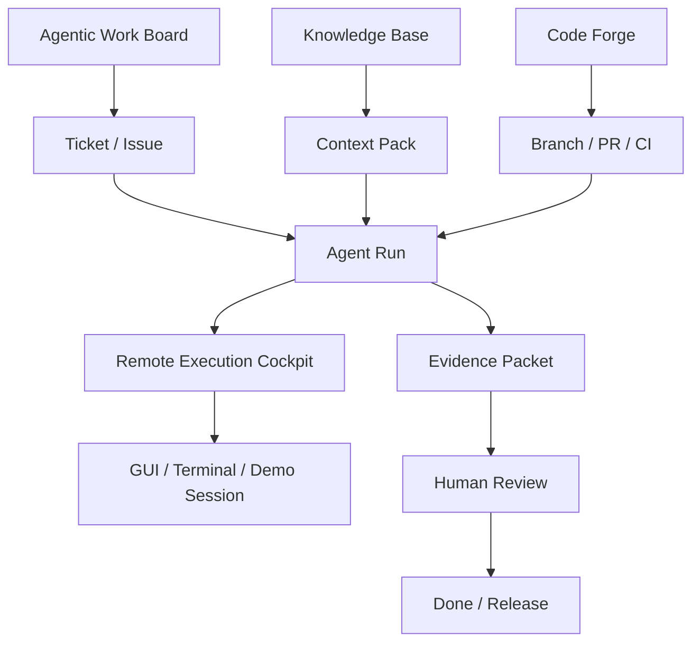

# North-Star Vision

## Product vision

Build a self-hosted AI-native engineering OS for restricted company networks.

The final platform connects five pillars:

1. **Work Board** - what must be done.
2. **Knowledge Base** - why, how, context and institutional memory.
3. **Code Forge** - code, review, CI/CD, packages and releases.
4. **Execution Layer** - human remote execution and AI agent execution.
5. **Governance Layer** - identity, policy, audit, approval and evidence.

## Product split

### Project A - Remote Execution Cockpit

Self-hosted remote access for internal PCs and workspaces. It gives humans secure GUI/terminal access, mobile control, demo sharing, audit and session policy.

### Project B - Agentic Desktop System

Local desktop AI worker. It operates files, terminal, browser, IDE/apps and project workflows. It supports frontier API keys when internet exists, internal model gateways in company networks, and local model servers as fallback.

### Project C - Agentic Work Board

Jira/Linear/Plane-style board where tickets are the control plane for agent work. Tickets contain goals, acceptance criteria, allowed tools, model profile, workspace, run timeline, approvals and evidence.

### Future Project D - Knowledge Base

Confluence-like documentation system for product docs, ADRs, runbooks, research notes, meeting notes and agent context packs.

### Future Project E - Code Forge

GitHub/GitLab/Gitea-style integration first, native forge later if justified. Connect tickets, docs, branches, PRs, CI, releases and evidence.

## Guiding principle

Do not make chat the center of the system. Make the work item the center of the system.

The user should manage work, not supervise multiple disconnected agent sessions.
