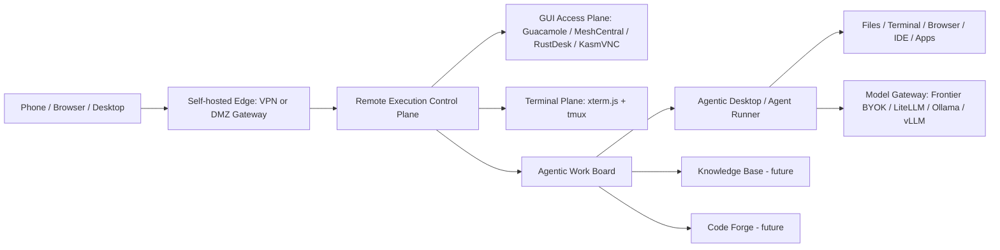

# Architecture Overview

## High-level system

## Core services

| Service | Responsibility | MVP status |
|---|---|---|
| Web/PWA | Browser and mobile UI | Must |
| API | REST/WebSocket API, auth, domain logic | Must |
| Session Broker | Start/join/terminate GUI and terminal sessions | Must |
| Resource Registry | PCs, workspaces, RDP/VNC/SSH/Mesh resources | Must |
| Gateway Adapter | VPN/DMZ profile integration | Must |
| Guacamole Adapter | RDP/VNC/SSH browser sessions | Must |
| MeshCentral Adapter | Managed PC integration | Should |
| Terminal Runner | tmux-backed terminals | Must |
| Work Board | Tickets, states, agent runs, evidence | Must for Project C |
| Agent Runner | Adapter layer for agent runtimes | Project B/C |
| Approval Service | Human gates for risky actions | Must |
| Evidence Service | Diffs, logs, screenshots, videos, summaries | Must |
| Audit Service | Immutable event log | Must |
| Policy Service | RBAC/ABAC, session/tool/resource policy | Must |
| Context Service | Code/doc knowledge graph and context packs | Future |
| Model Gateway | BYOK and local/internal model routing | Project B |

## Integration rule

Projects are separated by runtime but share contracts:

- identity model
- device model
- resource model
- session model
- ticket model
- agent run model
- approval model
- evidence model
- audit event model
- capability model

This enables independent releases without losing integration.
