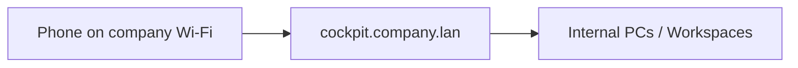
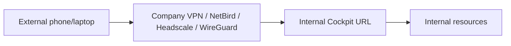
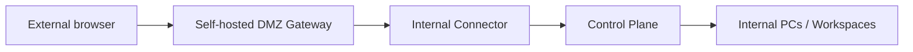

# Network Topologies

## Topology A - LAN-only

Used when the user device is on company Wi-Fi/LAN.

Use for labs, factories, internal demos and offline sites.

## Topology B - VPN-first

Used when external users can join the company private network through a self-hosted VPN or mesh.

Recommended for trusted employees and managed devices.

## Topology C - DMZ-first

Used when users should not receive full network access. They access one gateway, which reaches internal services through a controlled route or outbound connector.

Recommended default for product UX: no VPN client for simple browser access, less broad network exposure.

## Rule

If there is no network path at all, remote operation is impossible. The missing path must be created with company VPN, DMZ gateway, private WAN, private APN/cellular, branch relay or direct LAN/Wi-Fi.

## MVP deployment profiles

- `lan-only`
- `vpn-first`
- `dmz-first`

All documentation and installers must identify which profile is active.
