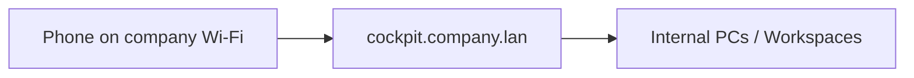
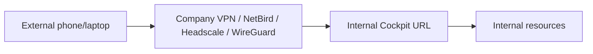
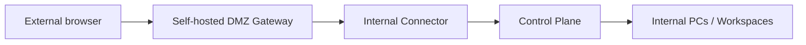

# Network Topologies

## Topology A - LAN-only

Used when the user device is on company Wi-Fi/LAN.

Use for labs, factories, internal demos and offline sites.

## Topology B - VPN-first

Used when external users can join the company private network through a self-hosted VPN or mesh.

Recommended for trusted employees and managed devices.

## Topology C - DMZ-first

Used when users should not receive full network access. They access one gateway, which reaches internal services through a controlled route or outbound connector.

Recommended default for product UX: no VPN client for simple browser access, less broad network exposure.

## Rule

If there is no network path at all, remote operation is impossible. The missing path must be created with company VPN, DMZ gateway, private WAN, private APN/cellular, branch relay or direct LAN/Wi-Fi.

## MVP deployment profiles

- `lan-only`
- `vpn-first`
- `dmz-first`

All documentation and installers must identify which profile is active.

## Profile → configuration mapping (v0.12.0, ADR-0068 §D1)

The product's only externally-bound process is Caddy (every service — api, audit,
broker, connector, policy, mcp-gateway — binds `127.0.0.1`). One variable,
`AIREOS_SITE_ADDRESS`, drives what Caddy serves and how it is reached; the profile
declares what sits in front of that edge and therefore what value the installer will
accept for it.

| Profile | What `AIREOS_SITE_ADDRESS` must be | What sits in front of Caddy |
|---|---|---|
| `lan-only` | Anything, including the `localhost`/loopback default. | Nothing extra — the LAN/Wi-Fi itself (Topology A). |
| `vpn-first` | A routable hostname or IP (loopback-only is **refused** — see below). | The company VPN/mesh (Topology B): NetBird, Headscale, WireGuard, or an equivalent the buyer's SOC already runs. |
| `dmz-first` | A routable hostname or IP (loopback-only is **refused**). | A self-hosted DMZ gateway/reverse proxy (Topology C) fronting this host's Caddy. |

`install.sh` **requires** `AIREOS_DEPLOYMENT_PROFILE ∈ {lan-only, vpn-first, dmz-first}`
(prompt-or-env, ADR-0051) and persists it in `aireos.env`; an absent or unrecognised
value fails the install loudly rather than defaulting. For `vpn-first`/`dmz-first` the
installer additionally **refuses** to proceed if `AIREOS_SITE_ADDRESS` resolves to a
loopback-only address (unset, `localhost`, `127.0.0.0/8`, `::1`, and their `http(s)://`/
bracketed/ported forms) — a routable edge is the entire point of choosing either
profile, and a loopback one would silently serve nothing reachable. `AIREOS_DEPLOYMENT_PROFILE`
never affects the profile-independent facts above: every service still binds
`127.0.0.1`, and Caddy is still the sole edge regardless of which profile is active.

## Verification depth — stated honestly (OI-25)

**`lan-only` is proven end-to-end** by `task wd1`: a real offline install, under real
systemd, with Caddy serving the SPA and the full governed-action chain exercised
against it.

**`vpn-first` and `dmz-first` are not.** No VPN, mesh, or DMZ gateway is stood up as
part of this product or its verification. What ships for these two profiles is: the
installer's enforced refusal of a loopback site address (unit-tested — see
`infra/offline/install_profile_test.sh`), and this documentation. Adopting a
VPN/ZTNA solution (NetBird, OpenZiti, Pangolin, Headscale) is deliberately declined for
Beta-1 (ADR-0068 §D1) — these remain Tier-1 watch items in
`references/source_watchlist.md`. A customer standing up either topology is the
trigger that would promote end-to-end proof of it back onto the roadmap.
