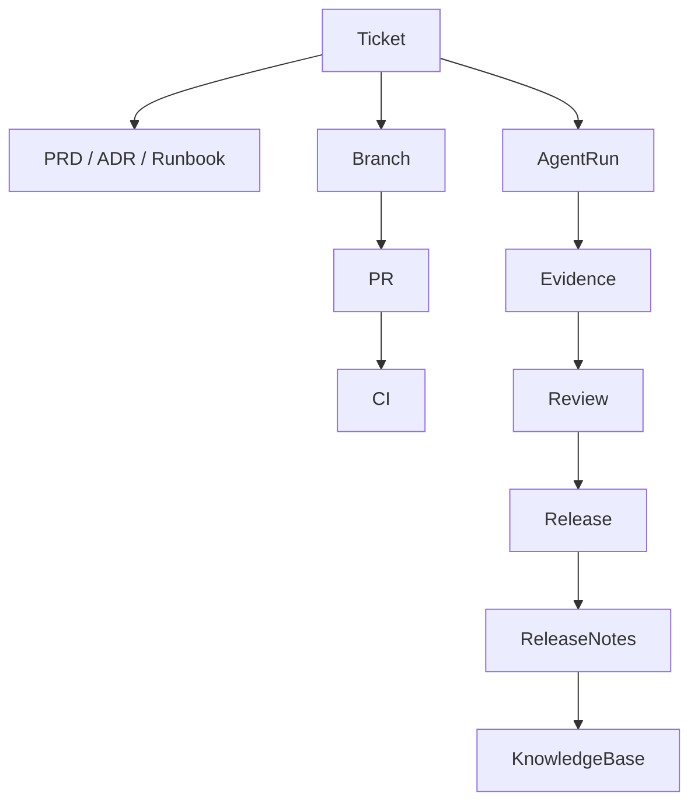

# Future Roadmap - Knowledge Base and Code Forge

## Decision

Your Atlassian/GitHub-inspired vision is valid and should be preserved as north-star roadmap, not MVP scope.

## Future Module D - Knowledge Base

A Confluence-style documentation system for humans and agents.

### Objects

- Space
- Page
- Page version
- Template
- Attachment
- Context pack
- Decision record
- Runbook
- Research note
- Product requirement
- Agent memory snapshot

### Use cases

- PRDs and feature specs.
- ADRs and system diagrams.
- Security runbooks.
- Customer discovery.
- Incident postmortems.
- Onboarding material.
- Agent context packs linked to tickets and code.
- Generated summaries from agent runs.

### Agent-native twist

Docs are not just storage. They are curated context. Tickets should reference precise docs and sections so agents receive a scoped context pack instead of an unbounded wiki dump.

## Future Module E - Code Forge

A GitHub/GitLab/Gitea-style layer.

### Recommended path

1. Integrate existing self-hosted forges first:
   - Gitea
   - Forgejo
   - GitLab self-managed
   - GitHub Enterprise Server
2. Link ticket -> branch -> PR -> CI -> evidence.
3. Build native forge features only if integrations are not enough.

### Future native features

- Repositories.
- Branches.
- Pull/merge requests.
- Protected branches.
- Code review.
- CI/CD runners.
- Package/container registry.
- Release management.
- Security scans.
- Compliance/audit views.

## Final platform graph

