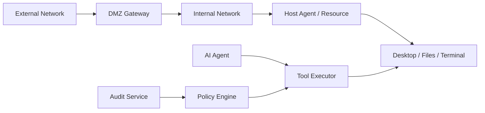

# Security Threat Model

## Core security principles

- No direct public RDP/SSH/VNC exposure.
- Least-privilege access to every resource.
- Session tokens are short-lived and scoped.
- QR is pairing, not credential transfer.
- Tool execution is approval-first.
- AI capabilities are separate from human observation/control.
- All important actions are audit events.
- Offline/self-hosted deployment must not weaken security.

## Trust boundaries

## Threats and mitigations

| Threat | Impact | Mitigation |
|---|---|---|
| Exposed RDP/SSH/VNC | Direct compromise | Gateway/VPN only, network scanner, deny public exposure |
| Stolen share link | Unauthorized viewing/control | Expiry, passcode, watermark, observe-only default, revoke |
| QR relay/phishing | Unauthorized pairing | Short expiry, single use, mutual confirmation, device labels |
| API key leakage | Vendor account compromise | OS keychain, no QR secrets, no logs, scoped secret store |
| Prompt injection | Agent misuse | Tool allowlist, approvals, sandbox, content trust boundaries |
| Excessive agency | Destructive action | Approval-first, command allowlist, protected resources |
| Malicious community skill | Supply-chain compromise | Private reviewed skill registry, signatures, static scan |
| File exfiltration | Data loss | Workspace boundaries, egress policy, DLP hooks later |
| Clipboard misuse | Secret leakage | Per-session clipboard policy, audit, redaction |
| Rogue admin | Insider threat | Dual-control for critical actions, audit export, SIEM |
| Replay/session hijack | Unauthorized action | Short-lived tokens, TLS/mTLS, nonce, binding to device |
| Offline patch lag | Vulnerability exposure | Offline patch feed, SBOM, release signing, upgrade runbook |

## AI mode separation

| Mode | Meaning | MVP default |
|---|---|---|
| Observe | AI or user can see | allowed by policy |
| Suggest | AI proposes actions | allowed |
| Control | human can click/type | approval/policy |
| Assisted action | AI requests tool call | approval-first |
| Autonomous action | AI acts without asking | disabled in MVP |

## Security gates

- Threat model review before MVP release.
- License review before embedding/forking AGPL projects.
- Offline install security checklist.
- Disaster recovery drill.
- Incident response runbook.
- Audit event tamper-resistance plan.
