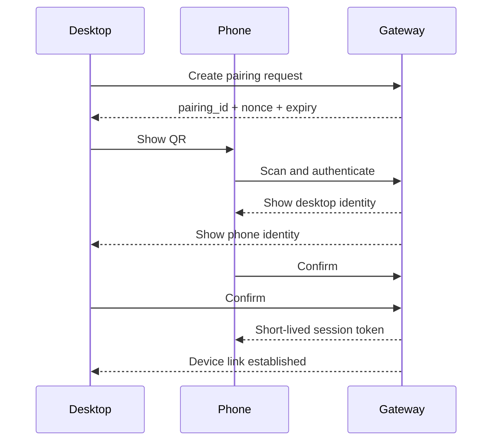

# UI/UX Specification

## UX principle

Hide network complexity. The user should think in terms of resources, sessions, tickets and approvals - not SSH tunnels or model endpoints.

## Remote Cockpit screens

1. Login
2. Network status
3. Resource picker
4. Session viewer
5. Terminal tab
6. Demo share
7. Audit timeline
8. Admin console

## Agentic Desktop screens

1. Project selector
2. Model provider settings
3. Task timeline
4. Approval modal
5. Diff viewer
6. Artifact viewer
7. QR phone dispatch
8. Logs/debug panel

## Work Board screens

1. Project board
2. Ticket detail
3. Agent run timeline
4. Approval queue
5. Evidence packet review
6. Backlog/roadmap later
7. Sprint/cycle view later

## Mobile touch mapping

| Gesture | Action |
|---|---|
| tap | left click |
| double tap | double click |
| long press | right click |
| two-finger drag | scroll |
| pinch | zoom |
| three-finger tap | shortcut drawer |
| floating keyboard | text input |
| hold-to-control | avoids accidental input |

## QR pairing flow

## Evidence review UX

A reviewer should see:

- summary
- acceptance criteria status
- diff
- tests
- screenshots/video
- risks
- approval history
- replay link if available
- accept / request changes / reject
