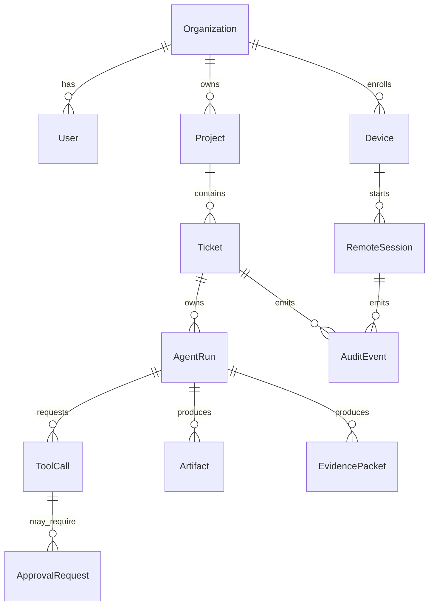

# Data Model

## Core entities



## Entity summaries

### Organization
Tenant boundary for users, devices, projects, policies and audit.

### User
Human account. Authenticated through local auth or external IdP.

### Device
PC, mobile, server, connector or agent desktop.

### Resource
Remote-controllable object: RDP, VNC, SSH, MeshCentral node, workspace, desktop agent.

### RemoteSession
A GUI, terminal, observe, control or demo session.

### Ticket
Agent-native work item with acceptance criteria, state, links and run history.

### AgentRun
A specific execution attempt by one agent/runtime/model in one workspace.

### ToolCall
Agent-requested action such as file write, shell command, browser operation or GUI action.

### ApprovalRequest
Human/policy decision required before a tool call or state transition.

### EvidencePacket
Review bundle containing summary, diff, logs, test results, screenshots/video and risks.

### Artifact
File output, patch, report, screenshot, video or generated document.

### AuditEvent
Immutable system event.

## Status enums

```text
RemoteSessionStatus:
  pending, active, suspended, ended, failed, terminated

TicketState:
  inbox, clarify, planned, ready_for_agent, running, needs_approval,
  blocked, evidence_review, human_review, ready_to_merge, done, failed, parked

AgentRunStatus:
  queued, preparing_workspace, running, needs_approval, paused, completed, failed, killed

ApprovalStatus:
  pending, approved, denied, expired, auto_denied
```
