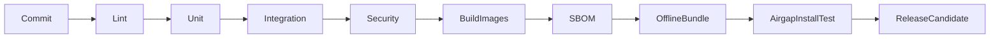

# Quality, Release and DevOps

## CI/CD pipeline

## Quality gates

| Gate | Requirement |
|---|---|
| Lint/typecheck | pass |
| Unit tests | pass |
| Integration tests | pass |
| API contract tests | pass |
| Security scan | pass or documented exception |
| License scan | pass or legal exception |
| SBOM | generated |
| Offline install | pass |
| Backup/restore | pass |
| Demo workflow | pass |
| Threat model | updated for release scope |

## Test matrix

- Browsers: Chrome, Edge, Firefox, Safari.
- Mobile: iOS Safari, Android Chrome.
- Remote targets: Windows RDP, Linux VNC/xrdp, SSH.
- Deployment: LAN-only, VPN-first, DMZ-first.
- Auth: local admin, OIDC/SSO.
- Network: high latency, reconnect, disconnect.
- Offline: no internet DNS/routes.

## Release artifacts

- versioned Docker images
- Docker Compose and Helm chart
- checksums
- signatures
- SBOM
- offline install guide
- upgrade guide
- rollback guide
- release notes
- known issues
