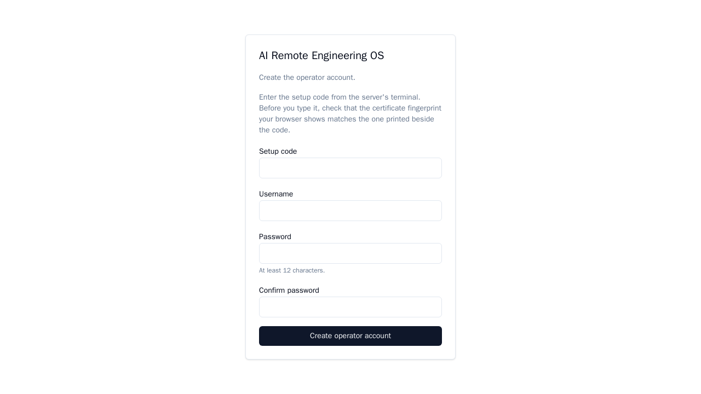
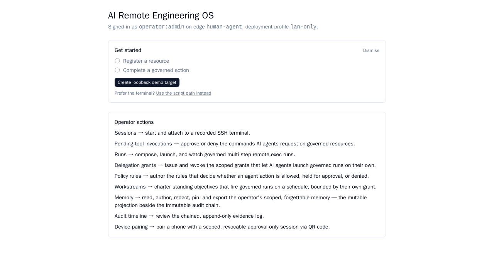

# Install guide

**What you will have at the end:** AI Remote Engineering OS running on a Linux server of your
own, and you signed in to its web page (the *cockpit*). **Time:** about 15 minutes. It works on
a server with no internet access. You build nothing, and you type **three commands on the
server**: check the downloads, unpack the application, run the setup script. Everything after
that happens in your browser.

## What you need

- **A server**: Ubuntu 24.04, Ubuntu 26.04 or Rocky/RHEL 9, `amd64`, and a login user that can
  run `sudo`. (Windows is a browser client only — there is no Windows server.)
- **A terminal on that server**: the server's own console, or `ssh <user>@<server-ip>` from
  your computer.
- **Five files** from the project's
  [**Releases** page](https://github.com/PaladinKnightMaster/ai-remote-engineering-os/releases/latest),
  all in **one folder** on the server — the folder your terminal opens in (your home
  directory) is what the commands below assume:

  | File | What it is |
  |---|---|
  | `aireos-offline-<version>.tar.gz` and its `.sig` | the application, and its signature |
  | `aireos-postgres-<os>.tar.gz` and its `.sig` | the PostgreSQL 16 companion **for your server's OS**, and its signature |
  | `aireos-release.pub` | the release public key |

  `<os>` is `ubuntu2404`, `ubuntu2604` or `rocky9`. Not sure which you run? `cat /etc/os-release`
  shows the name and version. Download only the companion for your OS; you do **not** unpack it:
  the setup script finds it beside the application folder.

  Copy the five files with `scp`, run on your computer, not on the server (built into
  PowerShell on Windows 10/11; any SFTP client works too):

  ```sh
  scp aireos-offline-<version>.tar.gz aireos-offline-<version>.tar.gz.sig aireos-postgres-<os>.tar.gz aireos-postgres-<os>.tar.gz.sig aireos-release.pub <user>@<server-ip>:
  ```

- **The key fingerprint** — a 64-character code in the Releases page notes. Read it through a
  different channel than the downloads (see [what verification proves](../../SECURITY.md#verifying-a-release-before-you-install-it)).
- **Optional: an SSH server on port 22 of the server**, for the demo target the quickstart uses
  (Ubuntu Server normally has one). Without it the install still works and the demo is skipped.

**How to read the commands.** Anything in `<angle brackets>` is a blank you must fill in, and
the text around it says what to put there. A line pasted with a blank still in it stops with an
error or a `NOT VERIFIED` — that is the safety net, so do not "fix" it by deleting only the
brackets. `<version>` is the version number in the name of the file you downloaded. A line
starting with `sudo` runs as administrator and may ask for your own login password.

## Words used in this guide

- **Governed action** — a command run on a machine through the product: checked against your
  rules, recorded, and held for a person's approval if you require that.
- **Resource** — a machine the cockpit is allowed to act on. The product keeps its login
  details, so people do not have to.
- **Run** — one or more commands you launch together from the cockpit and watch to the end.
- **Deployment profile** (`lan-only`) — a setting for where the cockpit can be reached from.
  `lan-only` means from your own network; it is the one tested end to end.
- **PostgreSQL companion** — a separate download that installs the database the application
  keeps its data in, without needing the internet.
- **Signature** — the `.sig` file that proves a download came from the project and has not been
  changed. You check it with the project's public key.
- **Fingerprint** — a short code that identifies that public key. Matching it against the
  Releases page tells you the key is the project's.
- **Setup code** — a one-time code the setup script prints. It proves, in the browser, that you
  are the person at the server's terminal.
- **Audit chain-head key** — a code the installer prints. With it, someone on another machine
  can later check that the audit log was not altered.
- **Cockpit** — the web page you sign in to, to use the product.

---

## The install: three commands

Run these in the folder holding the five files. Nothing is extracted or run before the first
one has said `ALL VERIFIED` — the archives contain programs that run as root.

<!-- rehearsal:begin -->

### 1. Check the downloads (one line)

Copy the fingerprint from the Releases page. Replace `<fingerprint>` with it, keeping the quotes,
and paste the whole line. It needs only `openssl`, already on the server:

```sh
( f=$(printf %s "<fingerprint>" | tr -d ': ' | tr A-F a-f); [ "${#f}" = 64 ] && [ "$(openssl pkey -pubin -in aireos-release.pub -pubout -outform DER | openssl dgst -sha256 | awk '{print $NF}')" = "$f" ] || { echo "NOT VERIFIED: aireos-release.pub does not have the fingerprint you pasted"; exit 1; }; v=; for t in aireos-*.tar.gz; do [ -f "$t" ] || continue; openssl pkeyutl -verify -pubin -inkey aireos-release.pub -rawin -in "$t" -sigfile "$t.sig" >/dev/null 2>&1 || { echo "NOT VERIFIED: $t (signature missing or wrong)"; exit 1; }; v="$v $t"; done; [ -n "$v" ] || { echo "NOT VERIFIED: no aireos-*.tar.gz in this folder"; exit 1; }; echo "ALL VERIFIED:$v" )
```

It checks that the public key is the one you were told to expect, then the signature of every
`aireos-*.tar.gz` in the folder, and prints one of two things:

```
ALL VERIFIED: aireos-offline-<version>.tar.gz aireos-postgres-<os>.tar.gz
```

or `NOT VERIFIED:` followed by what failed. **Only `ALL VERIFIED`, naming both archives, means
go on.** Anything else means **stop**: do not extract or run anything. (An unreplaced
`<fingerprint>`, a mistyped one, a missing `.sig` and a damaged download all print
`NOT VERIFIED` — the line cannot pass by accident.)

### 2. Unpack the application (one line)

```sh
tar -xzf aireos-offline-<version>.tar.gz
```

Unpack **only** this archive. Leave `aireos-postgres-<os>.tar.gz` as it is, beside the new
`aireos-offline-<version>` folder.

### 3. Run the setup script (one line)

```sh
sudo AIREOS_SITE_ADDRESS=<address> ./aireos-offline-<version>/setup.sh
```

Replace `<address>` with what people will type in their browser to reach the cockpit: the
server's IP address (`ip -4 addr` shows it — the one on your network, not `127.0.0.1`) or a DNS
name that resolves to it. **If you will only ever open the browser on the server itself**, drop
`AIREOS_SITE_ADDRESS=<address>`: the line is then `sudo ./aireos-offline-<version>/setup.sh`
and the address is `localhost`. The variable goes **after** `sudo` — `sudo` discards variables
set before it.

The script checks everything before it changes anything, then asks **two questions**:

1. **`Deployment profile [lan-only|vpn-first|dmz-first]:`** — type `lan-only`.
2. **`Set up the demo target? [Y/n]`** — it first says what it would create: a local account
   `aireos-demo` with no password, and one restricted SSH key for it (the key can run commands,
   cannot open a terminal or forward ports, and its private half is generated and kept inside
   the product, never written to disk). Press Enter for Yes. It is what lets the quickstart run
   a governed action with one click and no further server command. Undo it later with
   `sudo ./aireos-offline-<version>/setup.sh --remove-demo`. It is skipped, with one sentence,
   if no SSH server answers on `127.0.0.1:22`.

Then it installs PostgreSQL and the application — a few minutes — and ends with this block
(the values are yours; the script prints the **full path** of the folder where this guide writes
`./aireos-offline-<version>`):

```
  Setup code:   ABCDE-FGHJK-MNPQR-STVWX      (works once, for 60 minutes)

  Before you type the code, check you are talking to this server. Your browser will warn that the certificate is not trusted:
  open its details, select the certificate named "Caddy Local Authority - ECC Intermediate", and check that its SHA-256 fingerprint is
      <32 pairs of hex digits, separated by colons>
  (If you import this server's certificate authority to remove the warning, its root certificate's SHA-256 fingerprint is
      <32 pairs of hex digits, separated by colons>)

  Missed it, or it expired?   sudo /home/<you>/aireos-offline-<version>/setup.sh --new-setup-code   (the old code then stops working)

[setup] Open https://<address>/ in your browser and enter the setup code to create the operator account.
[setup] In the cockpit, click Create loopback demo target.
```

(The last line appears only if the demo target was prepared.)

**Keep this window open.** A little above the demo question, a line starting
`[install] AUDIT CHAIN-HEAD PUBLIC KEY` carries the audit chain-head key. Copy it somewhere
that is **not this server**: with it, anyone can later check, with no access to this server,
that an exported audit log has not been altered (procedure:
[Step 4 of the v0.13.0 verification runbook](../releases/v0.13.0/verification_runbook.md)).

⚠ **Run `setup.sh` again before setup is finished and it prints a NEW setup code; the old one
stops working.** Use the newest one.

<!-- rehearsal:end -->

## In the browser

Everything from here is in a browser on a machine that can reach the server. Your name, ids and
times will differ from the pictures.

**1. Open the address** the script printed (`https://<address>/`). **Expect a certificate
warning**: the cockpit uses a certificate from its own private authority, which your browser has
not heard of. Choose the warning page's "Advanced" and proceed option. (The warning's wording
differs by browser. To stop it for good: [Trusting the certificate](#trusting-the-certificate).)

**2. Check the certificate before you type the code.** The setup page is on screen, and the
script printed a fingerprint for you to compare. Open the certificate details, select the
certificate named **Caddy Local Authority - ECC Intermediate**, and compare its **SHA-256**
fingerprint with the first one the script printed (ignore colons and spaces). It is the
*intermediate* you compare, not the root: the server only sends the intermediate, so the root is
not in the browser's list. The root's fingerprint is for importing the authority.

- **Chrome / Edge:** click **Not secure** in the address bar, then **Certificate is not valid**.
  In the viewer, open the **Details** tab, select the certificate named above in the
  hierarchy, and read **SHA-256** under its fingerprints.
- **Firefox:** on the warning page choose **Advanced…**, then **View Certificate**. The viewer
  has one tab per certificate in the chain: open the tab named above and read **SHA-256**
  under **Fingerprints**.

⚠ These menu names are written from how the browsers label them, **not checked in a running
browser for this release** — what *is* checked is that the server really sends a certificate
with this name and the printed fingerprint (the later-host test asserts it). If a menu differs,
look for the certificate's name in the chain and its SHA-256 fingerprint. If the fingerprint
does **not** match, stop: do not type the code.

**3. Create the operator account.** Enter the setup code, choose a username and a password of
**at least 12 characters**, confirm it, and click **Create operator account**. Write the
username and password down: they are the cockpit login.



**What you should see:** the Dashboard, a header reading "Signed in as `<your username>` on edge
`human-agent`, deployment profile `lan-only`", and a **"Get started"** panel. If you said Yes to
the demo, the panel has a **"Create loopback demo target"** button. The setup page is gone for
good: it exists only until the first operator does.



**4. Check the services (optional).** On the server, expect the word `active` eight times
(`aireos-postgres` is the companion):

```sh
systemctl is-active aireos-api aireos-audit aireos-broker aireos-connector aireos-policy aireos-mcp-gateway aireos-caddy aireos-postgres
```

The server is now where the quickstart starts.

## Next: the quickstart

**[Run your first governed action →](quickstart-first-governed-action.md)** A few minutes, from
this installation to a completed, audited action.

---

## Something went wrong?

Find the message you see in the left column. Messages are quoted from the scripts and the cockpit.

| What you see | What it means | What to do |
|---|---|---|
| `NOT VERIFIED: …` (command 1) | The key, a signature or a download is wrong or missing. | Extract nothing. Download the named file again from the Releases page, copy it over, and repeat command 1. If it fails again, stop and ask. |
| `This must run as root: use  sudo …` | You ran `setup.sh` without `sudo`. | Run it again with `sudo` at the start of the line, exactly as shown. |
| `… is not an unpacked AI ReOS bundle (bin/ web/ config/ are missing); unpack the aireos-offline tarball again.` | The path before `/setup.sh` is not the unpacked application folder. | Run command 2 again, then command 3 with the folder it created. |
| `The PostgreSQL companion for this OS is missing: expected the file … Download aireos-postgres-<os>.tar.gz into the same folder as the unpacked aireos-offline folder and run this again. Nothing was changed.` | The companion for your OS is not beside the unpacked folder. | Copy it there (it is not unpacked) and run command 3 again. |
| `This host (…) has no bundled PostgreSQL; supported are Ubuntu 24.04, Ubuntu 26.04 and Rocky/RHEL 9.` | Your OS has no companion. | Use your own PostgreSQL 16: [Bring your own PostgreSQL](offline-postgres-install.md#bring-your-own-postgresql-16). |
| `The host library … is older than this PostgreSQL build needs: it does not provide …` (INS-11) | The server is older than the oldest point release the companion was built for (Ubuntu 24.04 and 26.04 GA, Rocky 9.0). | Apply the OS's updates and run command 3 again, or bring your own PostgreSQL. Nothing was changed. |
| `TCP port 5432 is already in use, probably by an existing PostgreSQL …` | Another PostgreSQL is on port 5432. It is left untouched. | Pick a free port and run `sudo AIREOS_PG_PORT=5433 ./aireos-offline-<version>/setup.sh`. |
| `The demo target was skipped: no SSH server answers on 127.0.0.1:22. AI ReOS itself is installed. …` | The server's SSH server is not on port 22 (or not running). | Nothing is broken. To add the demo: start an SSH server on 22 and run `sudo AIREOS_LOOPBACK_DEMO=yes ./aireos-offline-<version>/setup.sh`; or use the [script path](#the-demo-by-script) for another port. |
| `AIREOS_SITE_ADDRESS '…' is not an address of this host, so browsers that use it will not reach Caddy here …` (a warning, the install continues) | The address you gave is not this server's (a typo, or the wrong machine). | Run command 3 again with the right `<address>`. It restarts the services; it prints a new setup code. |
| The browser cannot connect, or the page fails at the address you typed | The cockpit answers only at the address you gave the script (default `localhost`). | Run command 3 again with the address you want. |
| `the setup code is invalid or has expired; run \`setup.sh --new-setup-code\` on the server for a new one` | The code is wrong, older than 60 minutes, already used, or locked after repeated wrong guesses (all five look the same on purpose). | On the server: `sudo ./aireos-offline-<version>/setup.sh --new-setup-code`. Use the new code. |
| `Use a password of at least 12 characters.` | The password is shorter than 12. | Choose a longer one. |
| `Setup is already complete. Reload the page to sign in.` | An operator exists. | Reload and sign in with the username and password you chose. `--new-setup-code` is refused once an operator exists. |
| `… is not staying active (state: …), so the install is NOT complete. Look at: journalctl -u … -n 50 --no-pager` (INS-10) | A service did not start or kept restarting. | Run the `journalctl` command it names, fix the first error, and run command 3 again. |
| `systemctl is-active` shows `failed`, `inactive` or `activating` | A service stopped. | `sudo journalctl -u <service-name> --no-pager -n 50`, fix, run command 3 again. |
| The browser warns that the connection is not private | Expected (see "In the browser", step 1). | Proceed, then check the fingerprint as in step 2. |

Trouble in the quickstart has its own list: [Something went wrong?](quickstart-first-governed-action.md#something-went-wrong).

---

# Reference

## Running setup.sh again, and existing v0.16.0 installs

`setup.sh` is safe to run again, and is how you correct a mistake such as a wrong address
(give `AIREOS_SITE_ADDRESS` again or leave it out to keep the one already saved). A re-run
restarts the seven services and keeps your keys, the generated database password, your operator
and the saved site address. It asks the deployment profile again (Enter keeps the saved one). Before an operator exists it prints a **new setup
code** and the old one stops working; `sudo ./aireos-offline-<version>/setup.sh --new-setup-code`
does only that and changes nothing else.

**A host that already runs v0.16.0** (its PostgreSQL came from the old package companion, its
`DATABASE_URL` is in `/etc/aireos/aireos.env`): the new `setup.sh` leaves that PostgreSQL and
URL alone, installs **no** companion, and says so — `This host already has an install whose
database is configured in /etc/aireos/aireos.env: that PostgreSQL is left untouched, and no
PostgreSQL companion is installed.` The operator you already have is kept, so there is no setup
code, and it ends `Setup is complete. Open <address> in your browser to continue.` Nothing is
migrated; to move onto the new companion you would install it deliberately, on a fresh host.

## Unattended install (no prompts)

Every question has an environment variable; supply them all and nothing is asked. **`sudo` drops
the environment, so the variables go after `sudo`** and before the script. The ones the scripts
really read:

| Variable | Meaning |
|---|---|
| `AIREOS_DEPLOYMENT_PROFILE` | `lan-only`, `vpn-first` or `dmz-first` (see [Deployment profiles](#deployment-profiles)). |
| `AIREOS_SITE_ADDRESS` | The address Caddy serves (default `localhost`; kept across re-runs). |
| `AIREOS_LOOPBACK_DEMO` | `yes` or `no`: the demo-target question. Unset and not a terminal means `no`. Anything else is refused before anything changes. |
| `AIREOS_PG_PORT` | The companion's TCP port (default 5432). |
| `AIREOS_DB_URL` | Bring your own PostgreSQL: `postgres://<user>:<password>@<host>:5432/<database>?sslmode=disable`. No companion is installed. |
| `AIREOS_BOOTSTRAP_OPERATOR_USER`, `AIREOS_BOOTSTRAP_OPERATOR_PASSWORD` | Make the operator now, so there is **no setup code and no browser setup**. Also `AIREOS_BOOTSTRAP_OPERATOR_PASSWORD_HASH`. |
| `AIREOS_PAIRING_ENABLED` | `1` turns on [phone pairing](#pairing-a-phone-optional). |
| `AIREOS_REMOVE_DEMO_ACCOUNT` | With `--remove-demo`: `yes` also deletes the account setup created. |

```sh
sudo AIREOS_DEPLOYMENT_PROFILE=lan-only AIREOS_SITE_ADDRESS=<address> AIREOS_LOOPBACK_DEMO=yes \
  ./aireos-offline-<version>/setup.sh
```

## Removing the demo, and rotating its key

`sudo ./aireos-offline-<version>/setup.sh --remove-demo` removes the demo's SSH login and its
pending key, and asks whether to delete the `aireos-demo` account too (only if setup created it;
`AIREOS_REMOVE_DEMO_ACCOUNT=yes|no` answers unattended). Two caveats:

- It removes **only the line it installed**. If you **rotated** the key in the cockpit and
  installed the new line yourself, that line stays: remove it from the account's
  `~/.ssh/authorized_keys` by hand.
- The cockpit's **"Remove the demo target"** deletes the resource but **not** the stored key (they
  live in separate services). To delete the key too:
  `sudo ./aireos-offline-<version>/setup-loopback-demo.sh --undo --resource-id <the resource id>`.

**Rotating a key** (Sessions → SSH keys → Rotate key) replaces it. **Until the new
`authorized_keys` line is installed on the target, the cockpit cannot connect to it** — the
cockpit says so before you confirm. See the quickstart's optional step.

## The old flow: `install.sh` and a companion by hand

`setup.sh` runs these for you; use them only to see the pieces or when you want the prompts. The
companion (`aireos-postgres-<os>.tar.gz`, verified as above) is unpacked and installed with a
password you choose (letters and digits only), then `install.sh` is run from the unpacked
application folder:

```sh
tar -xzf aireos-postgres-<os>.tar.gz
sudo COCKPIT_PW=<password> ./aireos-postgres-<os>/install-postgres.sh
cd aireos-offline-<version>
sudo AIREOS_SITE_ADDRESS=<address> AIREOS_DEPLOYMENT_PROFILE=lan-only ./install.sh
```

A bare `install.sh` **asks in the terminal** for the operator username and password, and for the
Postgres URL the first script printed (`postgres://cockpit:` + your password +
`@localhost:5432/cockpit?sslmode=disable`; a malformed URL is refused and asked again). It
makes the operator at the terminal; **no setup code and no browser setup**. For your own
PostgreSQL see the [database reference](offline-postgres-install.md).

## See the key's fingerprint yourself (optional)

Command 1 compares the fingerprint for you. To see it, and compare it by eye with the published
one, character for character:

```sh
openssl pkey -pubin -in aireos-release.pub -pubout -outform DER | openssl dgst -sha256
```

## The demo by script

`setup.sh` prepares the demo for you. The terminal path remains for a server where you said No, or whose SSH server is not on port 22. Run these as root from the unpacked application folder (`cd aireos-offline-<version>`):

```sh
sudo useradd -m -s /bin/bash aireos-demo
sudo ./setup-loopback-demo.sh generate --account aireos-demo
```

`generate` asks the connector for a key (its private half never reaches the disk here), installs the public half in the account's `authorized_keys` with the same restrictions as above, and prints the values the cockpit's **"Use the script path instead"** form asks for: `host`, `port`, `username` and `ssh host key`. Fill that form in, then run the `bind` command the Dashboard shows (`sudo ./setup-loopback-demo.sh bind --resource-id <id>`). `--port` exists for an SSH server not on 22 (the one-click button always uses 22). `sudo ./setup-loopback-demo.sh --undo [--resource-id <id>]` reverses it, in any order, and is safe to repeat.

## Deployment profiles

Every install declares a deployment profile — `lan-only`, `vpn-first` or `dmz-first` (see
[network topologies](../deep-dive/03-network-topologies.md)). There is no default. Without
`AIREOS_DEPLOYMENT_PROFILE` in the command the installer asks; an empty answer (when no earlier
run saved one) or an unrecognised value stops it before it changes anything. A value in the
command wins over one saved by an earlier run, which wins over the prompt.

`vpn-first` and `dmz-first` also **refuse** a loopback-only site address, because those
profiles exist to be reached from outside the server. Give them a routable name or IP, or
install as `lan-only`. Only `lan-only` has been proven end to end.

## Pairing a phone (optional)

Setting `AIREOS_PAIRING_ENABLED=1` turns on QR device pairing: a phone can be paired to a
narrow, revocable operator session that can read and approve or deny pending approvals, and
nothing else. It is **off by default**, and with it off every pairing route answers `404`.
Nothing prompts for it. A value you set is saved, so a later plain `setup.sh` re-run keeps
it; `AIREOS_PAIRING_ENABLED=0` turns it off again.

```sh
sudo AIREOS_SITE_ADDRESS=<address> AIREOS_DEPLOYMENT_PROFILE=lan-only AIREOS_PAIRING_ENABLED=1 ./aireos-offline-<version>/setup.sh
```

## Trusting the certificate

Caddy serves `https://<address>` with a certificate issued by a private certificate authority
it created on this server. To stop browsers warning, import that authority's root
certificate into the operators' browsers or operating systems. Its file is, by default:

```sh
sudo cat /var/lib/aireos/caddy/caddy/pki/authorities/local/root.crt > aireos-ca-root.crt
```

(If that path does not exist, `sudo find /var/lib/aireos/caddy -name root.crt` finds it.)
Copy `aireos-ca-root.crt` to the operators' machines. Alternatively, put your own certificate
in: edit `/etc/aireos/Caddyfile`, replace `tls internal` with `tls <certificate-file>
<key-file>`, and run `sudo systemctl restart aireos-caddy`. Note that re-running `setup.sh`
(or `install.sh`) puts the stock `Caddyfile` back.

## What the installer does

`setup.sh` installs the PostgreSQL companion, then runs `install.sh`, which creates the `aireos` system user and `/opt/aireos`, `/etc/aireos`, `/var/lib/aireos`;
installs the programs and the web app; generates the cluster's signing keys on the server;
creates the operator account (or, on the `setup.sh` path, leaves it to the browser setup); writes `/etc/aireos/aireos.env` (readable by `aireos` only);
checks the database and runs every migration; then enables and (re)starts seven systemd
services: `aireos-api`, `aireos-audit`, `aireos-broker`, `aireos-connector`, `aireos-policy`,
`aireos-mcp-gateway` and `aireos-caddy`.

**Why verify before extracting.** The installer runs from inside the extracted bundle, so it can
never check the archive it came from, and the PostgreSQL companion's installer runs as root.

---

# For maintainers: build, sign and release

**You do not need anything below this line to install.** It is for the person who produces the
release artifacts.

## What ships

| Artifact | Contents | Built by |
|---|---|---|
| `aireos-offline-<version>.tar.gz` (~45 MB) | static `linux/amd64` binaries (api, audit-service, session-broker, connector-service, policy-service, mcp-gateway, authctl, aireos-verify) + Caddy + the web app + `Caddyfile` + systemd units + `setup.sh` + `install.sh` + `setup-loopback-demo.sh` + `SHA256_MANIFEST.txt` | `task offline-bundle` |
| `aireos-postgres-<ostag>.tar.gz` (~7 MB) | a self-contained PostgreSQL 16 + pgcrypto tree (installed under `/opt/aireos/pgsql`; it never touches the OS package manager) + `install-postgres.sh` + the `aireos-postgres.service` unit + `SHA256_MANIFEST.txt` | `build-postgres-companions.sh` |

Design records: ADR-0051 (architecture) and ADR-0077 (the self-contained PostgreSQL companion,
which refines ADR-0052's packaging). OS scope: Ubuntu 24.04, Ubuntu 26.04 and
Rocky/RHEL-family 9, amd64.

## Build (connected host)

```sh
task offline-bundle                                           # core bundle
bash infra/offline/postgres/build-postgres-companions.sh ubuntu2404 ubuntu2604 rocky9
# artifacts land in dist/offline/ ; verify with sha256sum -c on the unpacked core bundle.
```

⚠ **`task offline-bundle` runs directly on the host — it needs Go 1.26, Node 22 and pnpm
installed there.** It does **not** containerise itself. On a host without them, run the build
inside a container that has both toolchains; the procedure the project itself uses is
recorded in `docs/releases/v0.15.0/verification_runbook.md` (Step 2).

**Sign both artifacts — a separate, host-side step, never part of the build above**
(ADR-0070 D1/D3). The release private key must never enter a build environment. Signing runs
afterward, on the machine holding the release private key:

```sh
task sign-release -- --key /path/to/aireos-release.key      # signs BOTH artifacts present
# -> dist/offline/aireos-offline-<version>.tar.gz.sig
# -> dist/offline/aireos-postgres-<ostag>.tar.gz.sig
```

**Both artifacts are signed, not just the core bundle.** The postgres companion is ~90 MB,
ships a full package repository, and runs `install-postgres.sh` as root on the target host —
leaving it unsigned would be indefensible (ADR-0070 Context, gap 1).

The signing step prints the public key's SHA-256 fingerprint — publish it in the release
notes (ADR-0070 D4) so an operator who obtains the public key over a second channel can
cross-check it. Transfer to the release page: both archives, both `.sig` files, and the
public key `aireos-release.pub` (SEC-44: the verifier is `openssl`, already on the target
host; only the public key needs distributing).

## Release key custody

**The production release key is never generated, stored, printed, or committed by any script
in this repo.** It is minted out-of-band by the maintainer, on a machine that never runs untrusted
build code:

```sh
openssl genpkey -algorithm ed25519 -out aireos-release.key
openssl pkey -in aireos-release.key -pubout -out aireos-release.pub
```

- The **private key** (`aireos-release.key`) is held by the maintainer, **never** committed
  to this repository, and **never** placed on a build host — the same host that runs
  `task offline-bundle`'s container must not also hold this key.
- It is **distinct from every key `install.sh` mints** (the per-workload PASETO keys,
  ADR-0069's chain-head key) — those are per-install and machine-generated; this one is
  per-project and human-held. Never substitute one for the other.
- The **public key** (`aireos-release.pub`) and its SHA-256 fingerprint are published with
  each release (out-of-band distribution, SEC-44) and never retired — key rotation is
  additive-forever (ADR-0070 D8): an operator verifying an older release needs the key it
  was signed under.
- **What the signature proves, stated plainly:** this artifact was produced by someone
  holding the release key and has not been altered since. **The signature itself** does not
  prove the build was clean, and does not tie the artifact to a source revision, and claims
  **no SLSA level** — releases are built and signed by the maintainer, with no CI (ADR-0070 D3). Separately — and NOT
  part of what the signature attests — every shipped Go binary embeds its own
  `vcs.revision`/`vcs.modified` (Go's `buildvcs` stamping, on by default, not stripped by
  `-trimpath -ldflags "-s -w"`); inspect with `go version -m bin/api`. That is a real,
  checkable provenance fact, but it is self-reported by the build and unsigned, and it is
  only trustworthy when the release is cut from a clean tree (`vcs.modified=false`).

**Testing the signing scripts without the release key:** mint a throwaway pair first, and never
commit it — see `infra/offline/testdata/fixture-release-key/README.md`. `task sec45-check` refuses to
run unless `RELEASE_PUBLIC_KEY` names the public key the artifacts were actually signed with.
