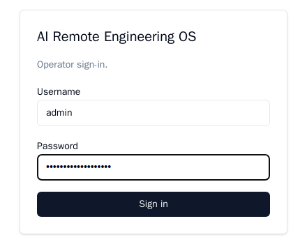
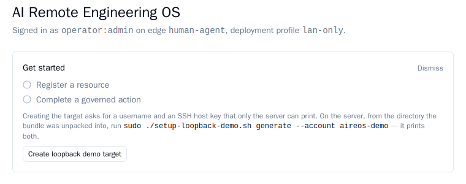
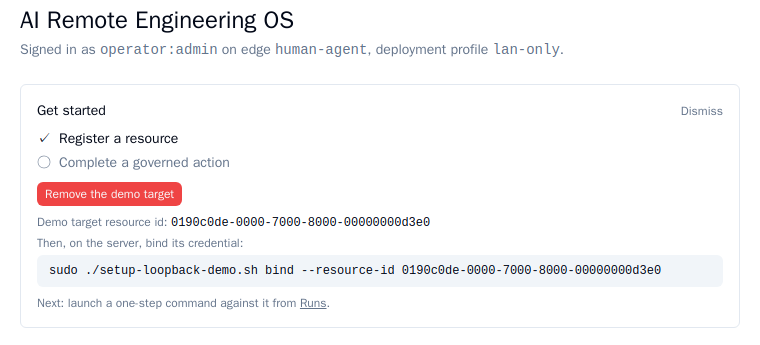
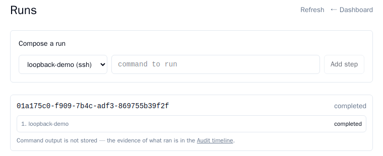
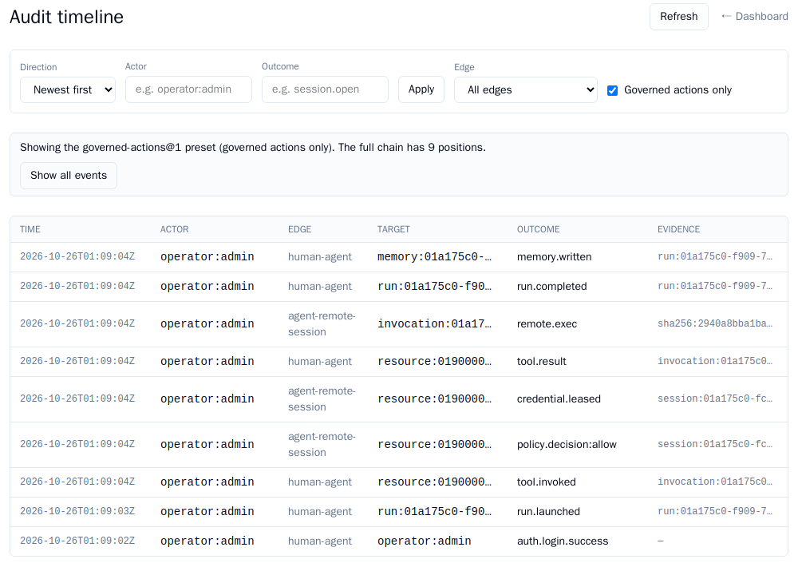

# Quickstart — your first governed action

**What you will have at the end:** one real command run through the cockpit, and the permanent
audit record of it on screen. **Time:** about 10 minutes.

**What you need:** the cockpit installed and running ([install guide](offline-install-v3.md),
steps 1–4), the operator username and password you chose there, a browser, and a terminal on the
server. New words (governed action, resource, Run, cockpit) are explained in
[Words used in this guide](offline-install-v3.md#words-used-in-this-guide).

**If a step does not match what you see, that is a defect in this document or in the product,
not in your environment** — check [Something went wrong?](#something-went-wrong), then report
it rather than improvising past it. Your user name, ids and times will differ from the
pictures.

**Where to run things.** Commands run **on the server**, in the directory where you unpacked
the application in the install guide's step 3 — `aireos-offline-<version>` (`<version>` is the
version number in the bundle's file name). Open a terminal on the server and go there first:

```sh
cd aireos-offline-<version>
```

If you open a new terminal or SSH session part-way through, run this `cd` again first: every
server command below must run from that directory.

---

## 1. Log in

In a browser, open `https://<address>` — the address you gave the installer — and sign in with
the operator username and password you chose in the install guide's step 3. A certificate
warning is expected there.



**What you should see:** the Dashboard, a header reading "Signed in as `<your operator
username>` on edge `human-agent`, deployment profile `lan-only`", and a **"Get started"** panel
with two unchecked items: **"Register a resource"** and **"Complete a governed action"**. (A
phone signed in through device pairing does not get this panel — use a normal browser login.)



---

## 2. Generate the demo target (on the server)

The demo target is the server logging in to itself over SSH, so you need no second machine. It
needs an SSH server listening on port 22 of this machine (Ubuntu Server normally has one).

Create a dedicated local account, then have the setup script generate a key and a restricted
login for it:

```sh
sudo useradd -m -s /bin/bash aireos-demo
sudo ./setup-loopback-demo.sh generate --account aireos-demo
```

(`--port` also exists, defaulting to `22`; you need it only if your SSH server listens
elsewhere. If `useradd` says the account already exists, carry on.)

**What you should see:** a few progress lines, ending with the four values you will paste
into the cockpit:

```
[loopback-demo] done — paste these into the cockpit's 'Create loopback demo target' action:
  host:         127.0.0.1
  port:         22
  username:     aireos-demo
  ssh host key: ssh-ed25519 AAAA…
```

The `ssh host key` is one long line starting with `ssh-ed25519` (or another key type your SSH
server offers — any is fine). Copy the username and that whole line. The new login can only
run commands — no port or agent forwarding, no terminal — and its private key stays on the
server.

---

## 3. Create the demo target in the cockpit

Back in the browser, click **"Create loopback demo target"** in the Dashboard's "Get started"
panel. A small form opens that shows `host` and `port` as fixed values (`127.0.0.1` and `22`).
Paste:

- **username** — `aireos-demo`
- **ssh host key** — the whole `ssh-…` line the script printed

Click **Create**.

**What you should see:** the first item flips to **"✓ Register a resource"**, and the panel now
shows the new resource's id ("Demo target resource id: …") and the exact `bind` command to run
on the server. That is the next step.



---

## 4. Bind the credential (on the server)

Copy the command from the panel (click it to select the whole line) and run it in the same
directory as before. It has this shape — use the one the panel shows, which carries your real
resource id:

```sh
sudo ./setup-loopback-demo.sh bind --resource-id <id-from-the-panel>
```

This hands the private key from step 2 to the connector, the one component allowed to hold
credentials.

**What you should see:** the output ends with `[loopback-demo] bound — the demo resource is
ready to run a governed action against`. If it says the value "is not a resource id", you ran
the template above without replacing the placeholder.

---

## 5. Launch a one-step Run

In the cockpit, open **Runs** (the link in the panel, or `/runs`). Under "Compose a run":

1. Select **loopback-demo (ssh)** from the resource dropdown.
2. Type a harmless command, e.g. `whoami`, into the command field.
3. Click **Add step**, then **Review & launch**.
4. On the review screen, confirm the single step reads back exactly the command you typed,
   then click **Confirm launch**.

This resource was created without requiring approval, so the step runs on its own, with nothing
waiting for a second operator.

**What you should see:** the new Run appears in the list below, its status moving from
`pending` or `running` to **`completed`** within a few seconds. Click the Run's id to expand
it: the step reads `1. loopback-demo` with its status, and a note says **"Command output is not
stored — the evidence of what ran is in the Audit timeline."** The cockpit records that the
command ran, under whose identity and what the policy decided, but never what it printed, so
you will not see `whoami`'s output on any screen.



Back on the Dashboard, the second item now reads **"✓ Complete a governed action"**, and the
panel says "All set — dismiss whenever you're ready."

---

## 6. See the events in the audit surface

Open **Audit** (`/audit`). It opens newest-first on its default view — no filter changes
needed. Among the events from your Run you should find **`run.launched`**, **`tool.result`** and
**`run.completed`**, with others beside them such as `tool.invoked`, `policy.decision:allow`,
`credential.leased`, `remote.exec` and `memory.written`. Every one shows your operator identity as the actor
(`operator:` followed by the username you chose). Together they are the permanent,
hash-chained record of the action.



---

## 7. Clean up

**In the cockpit**, on the Dashboard panel, click **"Remove the demo target"**. It should
succeed immediately (if it says "resource is in use", see
[Something went wrong?](#something-went-wrong)).

**On the server**, from the same directory, undo the SSH and credential side:

```sh
sudo ./setup-loopback-demo.sh --undo
```

This removes the login the script added to `aireos-demo` (matched by its own marker comment, so
nothing you added by hand is touched) and the stored credential, if one was bound. It is
safe to run again, or out of order. The `aireos-demo` account itself stays; remove it with
`sudo userdel -r aireos-demo` if you do not want it.

---

## Something went wrong?

| What you see | What it means | What to do |
|---|---|---|
| `ERROR: must run as root` | You ran a script without `sudo`. | Run it again with `sudo` at the start of the line, as shown above. |
| `bind: '…' is not a resource id. A resource id is 36 characters: 8-4-4-4-12 hex digits separated by dashes …` | You pasted the template (or other text) instead of the real id. | Copy the exact `bind` command from the cockpit panel (step 3) and run that. |
| `no such account 'aireos-demo' — create the dedicated demo account first` | The `useradd` line in step 2 was skipped. | Run `sudo useradd -m -s /bin/bash aireos-demo`, then step 2's second command again. |
| `no sshd reachable on 127.0.0.1:22 (and neither the ssh/sshd service nor ssh.socket is active) — install and start one before running this script` | This server has no running SSH server. | Install and start one (on Ubuntu, the `openssh-server` package), then run step 2 again. |
| The "Create loopback demo target" button is missing | It shows only while no resource exists, so a resource was already created. | Carry on from the `bind` command the panel shows (step 4), or remove the demo target and start again at step 2. |
| `Could not remove the demo target: resource is in use` (the server calls it `409 Conflict`) | A terminal session was opened against this resource at some point. That blocks deleting it for good. | Nothing to fix — leave it and carry on. Run only the server-side `--undo` in step 7. |
| A browser page will not load, or a service is not `active` | An install problem, not a quickstart one. | See the install guide's [Something went wrong?](offline-install-v3.md#something-went-wrong). |

---

## Optional: enabling pairing

Device pairing (a phone approving from a QR-paired session) is **off by default**. How to
turn it on, and what a re-run of the installer keeps, is in the install guide's
[Pairing a phone](offline-install-v3.md#pairing-a-phone-optional).

---

## Honest limits — read this before you file a bug

**Only the `lan-only` deployment profile has been proven end to end.** This quickstart runs on
it. `vpn-first` and `dmz-first` are enforced at install time and described in
[network topologies](../deep-dive/03-network-topologies.md#verification-depth--stated-honestly-oi-25),
but no VPN or DMZ gateway has been stood up against this product — do not read a clean
walkthrough on `lan-only` as evidence for the other two.

**An operator cannot see the output of a command.** It is not stored anywhere, by design for
now; the audit trail proves a command ran and under which decision, not what it printed.

**A resource that has ever had a terminal session opened against it cannot be deleted.** The
database keeps a permanent link from each session to its resource, so the cockpit reports
`409 Conflict` ("resource is in use") and it will not go away short of a schema change. This
walkthrough uses a **Run**, never a terminal session (`/sessions`), so it stays clean.
