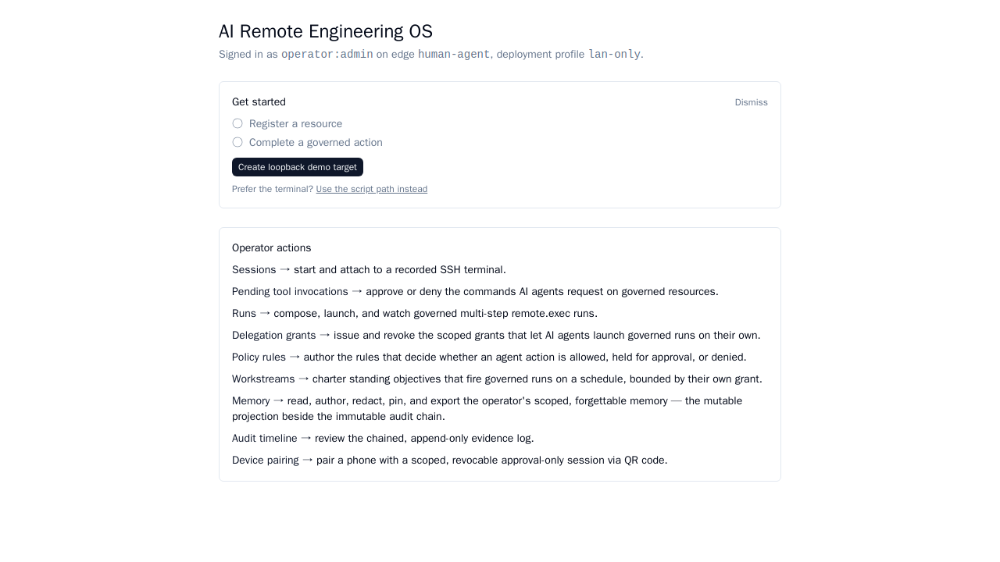
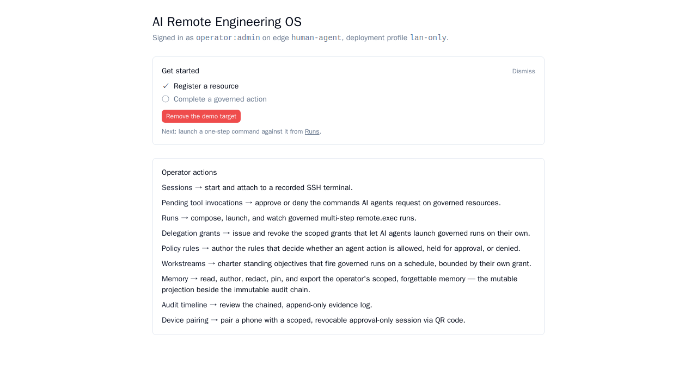
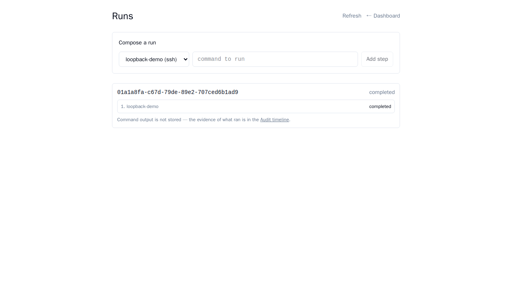
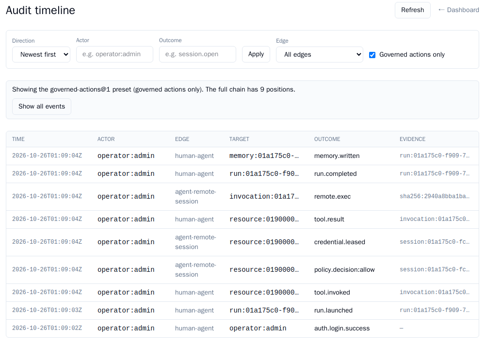

# Quickstart — your first governed action

**What you will have at the end:** one real command run through the cockpit, and the permanent
audit record of it on screen. **Time:** a few minutes, **all in the browser**.

**What you need:** the install finished and the operator account created in the browser
([install guide](offline-install-v3.md)), and **Yes** answered to its demo-target question. New
words (governed action, resource, Run, cockpit) are explained in
[Words used in this guide](offline-install-v3.md#words-used-in-this-guide).

**If a step does not match what you see, that is a defect in this document or in the product,
not in your environment** — check [Something went wrong?](#something-went-wrong), then report
it rather than improvising past it. Your user name, ids and times will differ from the
pictures (they come from a throwaway test stack).

---

## 1. Open the Dashboard

Right after the install guide's browser setup you are already signed in and on the Dashboard. To
come back later, open `https://<address>` — the address the setup script printed — and sign in
with the username and password you chose on the setup page. A certificate warning is expected
there.

**What you should see:** the Dashboard, a header reading "Signed in as `<your operator
username>` on edge `human-agent`, deployment profile `lan-only`", and a **"Get started"** panel
with two unchecked items: **"Register a resource"** and **"Complete a governed action"**, and a
**"Create loopback demo target"** button. (A phone signed in through device pairing does not get
this panel — use a normal browser login.)



---

## 2. Create the demo target (one click)

The demo target is the server logging in to itself over SSH, so you need no second machine. The
setup script already prepared its restricted login and key. Click **"Create loopback demo
target"**. There is nothing to paste and nothing to run on the server.

**What you should see:** the first item flips to **"✓ Register a resource"**, a red **"Remove
the demo target"** button appears, and the panel says "Next: launch a one-step command against
it from Runs."



If instead you see "The demo target was not prepared when this server was installed. Re-run sudo
./setup.sh and answer yes to the demo, or use the script path (setup-loopback-demo.sh) below.",
see [Something went wrong?](#something-went-wrong).

---

## 3. Launch a one-step Run

Open **Runs** (the link in the panel, or `/runs`). Under "Compose a run":

1. Select **loopback-demo (ssh)** from the resource dropdown.
2. Type a harmless command, e.g. `whoami`, into the command field.
3. Click **Add step**, then **Review & launch**.
4. On the review screen, confirm the single step reads back exactly the command you typed,
   then click **Confirm launch**.

This resource was created without requiring approval, so the step runs on its own, with nothing
waiting for a second operator.

**What you should see:** the new Run appears in the list below, its status moving from
`pending` or `running` to **`completed`** within a few seconds. Click the Run's id to expand
it: the step reads `1. loopback-demo` with its status, and a note says **"Command output is not
stored — the evidence of what ran is in the Audit timeline."** The cockpit records that the
command ran, under whose identity and what the policy decided, but never what it printed, so
you will not see `whoami`'s output on any screen.



Back on the Dashboard, the second item now reads **"✓ Complete a governed action"**, and the
panel says "All set — dismiss whenever you're ready."

---

## 4. See the events in the audit surface

Open **Audit** (`/audit`). It opens newest-first on its default view — no filter changes
needed. Among the events from your Run you should find **`run.launched`**, **`tool.result`** and
**`run.completed`**, with others beside them such as `tool.invoked`, `policy.decision:allow`,
`credential.leased`, `remote.exec` and `memory.written`. Every one shows your operator identity as the actor
(`operator:` followed by the username you chose). Together they are the permanent,
hash-chained record of the action.



(This picture is from an earlier install: yours also has setup and demo events, such as
`setup.completed`, `resource.created` and `credential.bound`, further down.)

---

## 5. Optional: see the key, and rotate it

Open **Sessions** (`/sessions`). Under **SSH keys**, click **"Key for loopback-demo"**. The cockpit
shows the key's **public half**, its **fingerprint**, and the exact line to add to the target
account's `~/.ssh/authorized_keys`, with a **Copy line** button. There is no place to type or
paste a private key: the private half is generated and kept inside the product and is never shown.

**Rotate key** replaces the key. The cockpit asks first — "Rotating replaces this key. Until you
install the new line on the target, the cockpit will not be able to connect to it." — and that is
exactly what happens: after **Rotate and replace the key**, **the next Run on this target fails**
until you install the new line. To do that, copy the new line with **Copy line**, then on the server
(replace `<the line you copied>`; keep the single quotes):

```sh
echo '<the line you copied>' | sudo -u aireos-demo tee -a /home/aireos-demo/.ssh/authorized_keys
```

and launch the Run again: it completes. The line you added by hand is **yours**: `setup.sh
--remove-demo` does not remove it (see below).

---

## 6. Clean up

**In the cockpit**, on the Dashboard panel, click **"Remove the demo target"**. It should
succeed immediately (if it says "resource is in use", see
[Something went wrong?](#something-went-wrong)). It deletes the resource, **not** the stored key.

**On the server**, undo the SSH side of the demo:

```sh
sudo ./aireos-offline-<version>/setup.sh --remove-demo
```

It removes the login `setup.sh` installed (matched by its own marker comment, so nothing you added
by hand is touched), asks `Also delete the local account "aireos-demo" and its home directory?
[y/N]`, and is safe to run again. **If you rotated the key, the line you installed by hand stays**:
remove it from `/home/aireos-demo/.ssh/authorized_keys` yourself (or answer `y` to delete the
account).

To delete the stored key as well, give it the demo resource's id. In **Audit**, type
`resource.created` in **Outcome**, click **Apply**, and hover over the **Target** cell of the event:
the full `resource:<id>` appears (the id is the part after `resource:`). Then:

```sh
sudo ./aireos-offline-<version>/setup-loopback-demo.sh --undo --resource-id <id>
```

---

## Something went wrong?

| What you see | What it means | What to do |
|---|---|---|
| The "Create loopback demo target" button is missing | It shows only while no resource exists, so a resource was already created. | Carry on at step 3, or remove the demo target and click again. |
| "The demo target was not prepared when this server was installed. …" | You answered No to the demo at setup, or the server had no SSH server on port 22 (the demo is then skipped). | On the server: `sudo AIREOS_LOOPBACK_DEMO=yes ./aireos-offline-<version>/setup.sh` (with the companion tarball still beside the folder; it keeps your operator and prints no code), then click again. Or use the [script path](offline-install-v3.md#the-demo-by-script). |
| `The demo target was skipped: no SSH server answers on 127.0.0.1:22. …` (from `setup.sh`) | No SSH server on port 22. | Install and start one (on Ubuntu, the `openssh-server` package), then run `setup.sh` again with `AIREOS_LOOPBACK_DEMO=yes`. For a server whose SSH is on another port use the script path. |
| The Run ends `failed`, or `remote.exec` is denied, right after rotating a key | The new key is not installed on the target. | Install the new line (step 5), then launch again. |
| `Could not remove the demo target: resource is in use` (the server calls it `409 Conflict`) | A terminal session was opened against this resource at some point. That blocks deleting it for good. | Nothing to fix — leave it and carry on. Run only the server-side `--remove-demo` in step 6. |
| `must run as root` | You ran a script without `sudo`. | Run it again with `sudo` at the start of the line, as shown above. |
| A browser page will not load, or a service is not `active` | An install problem, not a quickstart one. | See the install guide's [Something went wrong?](offline-install-v3.md#something-went-wrong). |

---

## Optional: enabling pairing

Device pairing (a phone approving from a QR-paired session) is **off by default**. How to
turn it on, and what a re-run keeps, is in the install guide's
[Pairing a phone](offline-install-v3.md#pairing-a-phone-optional).

---

## Honest limits — read this before you file a bug

**Only the `lan-only` deployment profile has been proven end to end.** This quickstart runs on
it. `vpn-first` and `dmz-first` are enforced at install time and described in
[network topologies](../deep-dive/03-network-topologies.md#verification-depth--stated-honestly-oi-25),
but no VPN or DMZ gateway has been stood up against this product — do not read a clean
walkthrough on `lan-only` as evidence for the other two.

**An operator cannot see the output of a command.** It is not stored anywhere, by design for
now; the audit trail proves a command ran and under which decision, not what it printed.

**A resource that has ever had a terminal session opened against it cannot be deleted.** The
database keeps a permanent link from each session to its resource, so the cockpit reports
`409 Conflict` ("resource is in use") and it will not go away short of a schema change. This
walkthrough uses a **Run**, never a terminal session (`/sessions` is only used to read the key), so it stays clean.
